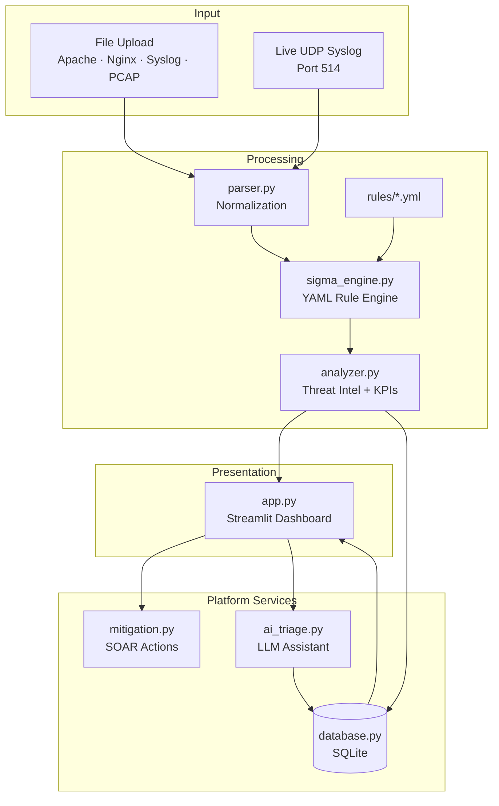

# SOC Log & Traffic Analyzer

A modular **SOC Triage Platform** for defensive security operations. Ingest logs and packet captures, run YAML-driven detections, enrich indicators with threat intelligence, automate SOAR containment playbooks, and persist investigation cases — all through a dark-themed analyst dashboard.

Built as a portfolio-grade project demonstrating blue-team engineering: log normalization, Sigma-inspired detection rules, live syslog forwarding, case management, and AI-assisted triage.

---

## Table of Contents

- [Overview](#overview)
- [How It Helps a SOC Analyst](#how-it-helps-a-soc-analyst)
- [Key Features](#key-features)
- [Architecture](#architecture)
- [Detection Rules](#detection-rules)
- [Project Structure](#project-structure)
- [Installation](#installation)
- [Configuration](#configuration)
- [Usage](#usage)
- [Tech Stack](#tech-stack)
- [Security Posture](#security-posture)
- [Roadmap](#roadmap)
- [License](#license)

---

## Overview

Security Operations Center (SOC) analysts spend much of their shift separating signal from noise across web access logs, authentication events, firewall records, and network captures. This platform automates the **first pass of triage**:

| Stage | What the platform does |
|---|---|
| **Ingest** | File upload (Apache, Nginx, Syslog, PCAP) or live UDP syslog streaming |
| **Normalize** | Parse disparate formats into a unified schema (IP, timestamp, status, path, ports) |
| **Detect** | Evaluate YAML rules — Sigma signatures and threshold aggregations |
| **Enrich** | Cross-reference external IPs with AbuseIPDB threat intelligence |
| **Respond** | Generate SOAR playbooks (iptables, Windows Firewall, AWS Security Group JSON) |
| **Persist** | Store cases, alerts, and AI triage notes in SQLite across restarts |
| **Visualize** | Render KPIs, timelines, and endpoint charts in a SOC-style dashboard |

This is a **decision-support and triage prototype**, not a production SIEM replacement. It demonstrates the pipeline logic that sits upstream of enterprise platforms such as Splunk, Elastic, Microsoft Sentinel, or Chronicle.

---

## How It Helps a SOC Analyst

| Analyst workflow | Platform capability |
|---|---|
| **Rapid triage** | Upload a log dump or stream syslog live; receive structured alerts in seconds instead of manual `grep` |
| **Repeatable detections** | Add or tune rules by dropping YAML files in `/rules` — no Python changes required |
| **Attack pattern recognition** | Flags brute-force bursts, directory traversal, recon probes, port scans, and SSH abuse |
| **Threat context** | External IPs enriched with AbuseIPDB abuse confidence scores and report counts |
| **Incident containment** | Per-alert SOAR actions: downloadable iptables scripts, PowerShell rules, AWS SG JSON |
| **Junior analyst mentoring** | Optional AI Triage Assistant summarizes *what happened* and *recommended next steps* |
| **Case continuity** | SQLite case management retains investigation history across application restarts |
| **Evidence validation** | Parsed log preview and live syslog tail for corroborating detections |
| **Safe local operation** | Runs on localhost; optional external calls limited to AbuseIPDB and configured LLM APIs |

---

## Key Features

- **YAML Rule Engine** — Sigma-inspired signatures plus sliding-window threshold rules (brute-force, port scan)
- **Live Syslog Ingestion** — Background UDP listener (default port 514) with auto-refreshing dashboard
- **Threat Intelligence** — AbuseIPDB integration with session caching and rate-limit awareness
- **SOAR Playbooks** — One-click mitigation artifacts; scripts are generated for review, never auto-executed
- **Case Management** — SQLite persistence for cases, ingestions, alerts, and analyst status
- **AI Triage Assistant** — Ollama (local) or OpenAI-compatible API for 2-sentence alert summaries
- **Defensive-only design** — Graceful handling of corrupt inputs; no exploit generation

---

## Architecture



### Data flow

1. **`parser.py`** — Normalizes Apache/Nginx combined logs, Linux syslog, and PCAP/PCAPNG into a unified pandas `DataFrame`.
2. **`sigma_engine.py`** — Loads all rules from `/rules`. Evaluates Sigma row-matching signatures and threshold window aggregations.
3. **`analyzer.py`** — Runs AbuseIPDB enrichment and computes dashboard KPIs. Contains no hardcoded detection signatures.
4. **`database.py`** — Persists cases, ingestions, alerts, and AI triage summaries to `data/soc_platform.db`.
5. **`mitigation.py`** — Builds per-alert SOAR artifacts (iptables, Windows Firewall, AWS Security Group JSON).
6. **`ai_triage.py`** — Optional LLM summarization for junior analyst guidance.
7. **`syslog_listener.py`** — Thread-safe UDP receiver for live SIEM-style log forwarding.
8. **`app.py`** — Streamlit UI with file upload, live stream, case management, and analyst action panels.

---

## Detection Rules

All detection logic is defined in YAML under `rules/`. Two rule types are supported:

### Sigma signatures (`detection` + `condition`)

Match keywords, field contains/regex patterns, and logsource filters per row.

| Rule file | Severity | Detects |
|---|---|---|
| `web_directory_traversal.yml` | Critical | `../`, `/etc/passwd`, `cmd.exe`, `.env` |
| `web_recon_probes.yml` | High | `wp-admin`, `phpmyadmin`, admin paths |
| `ssh_bruteforce_keywords.yml` | Medium | `Failed password`, `Invalid user` in syslog |

### Threshold rules (`type: threshold`)

Sliding-window aggregations per source IP.

| Rule file | Severity | Detects |
|---|---|---|
| `http_brute_force.yml` | High | ≥ 5 HTTP 401/403 responses per IP within 5 minutes |
| `pcap_port_scan.yml` | High | ≥ 10 unique destination ports per IP within 60 seconds |

### Threat intelligence

| Rule ID | Trigger |
|---|---|
| `threat_intel_abuseipdb` | External IP with AbuseIPDB abuse score ≥ 50 |

**Adding a custom rule:** create a new `.yml` file in `rules/` and restart the application (or call `get_rule_engine().reload()`).

Example threshold rule:

```yaml
title: SQL Injection Probe
id: 00000000-0000-4000-8000-000000000099
type: threshold
level: high
logsource:
  category: webserver
detection:
  selection_sqli:
    request_path|contains:
      - "UNION SELECT"
      - "' OR 1=1"
  condition: selection_sqli
```

---

## Project Structure

```
Scan_logs/
├── app.py                  # Streamlit dashboard (entry point)
├── parser.py               # Log & PCAP normalization
├── analyzer.py             # Threat intel enrichment + KPI aggregation
├── sigma_engine.py         # Unified YAML rule engine
├── models.py               # Shared Alert dataclass
├── database.py             # SQLite case management
├── mitigation.py           # SOAR playbooks (iptables / Windows / AWS)
├── ai_triage.py            # Ollama / OpenAI triage assistant
├── syslog_listener.py      # Live UDP syslog receiver
├── config.py               # Central configuration
├── requirements.txt
├── .env.example
├── data/                   # SQLite DB (auto-created, gitignored)
├── rules/                  # Detection rules (YAML)
├── samples/                # Demo log files
├── tools/
│   └── send_test_syslog.py # UDP test sender for live stream demo
└── README.md
```

---

## Installation

### Prerequisites

| Requirement | Notes |
|---|---|
| **Python 3.10+** | Tested on 3.10–3.12 |
| **pip** | Package manager |
| **Modern browser** | Chrome, Firefox, or Edge |
| **Administrator/root** | Only required for binding UDP port 514 |

> **Windows note:** Scapy may print `No libpcap provider available` on import. This does not affect offline PCAP parsing. [Npcap](https://npcap.com/) is only needed for live capture, which this tool does not perform.

### Steps

```bash
# 1. Clone the repository
git clone https://github.com/<your-username>/soc-log-analyzer.git
cd soc-log-analyzer

# 2. Create and activate a virtual environment
python -m venv .venv

# Windows (PowerShell)
.venv\Scripts\activate

# macOS / Linux
source .venv/bin/activate

# 3. Install dependencies
pip install -r requirements.txt

# 4. Configure environment variables
cp .env.example .env
# Edit .env with your API keys (all optional except for full feature set)

# 5. Launch the dashboard
streamlit run app.py
```

The application opens at **http://localhost:8501**.

---

## Configuration

Copy `.env.example` to `.env` and adjust as needed.

### AbuseIPDB (threat intelligence)

```env
ABUSEIPDB_API_KEY=your_api_key_here
```

Register free at [abuseipdb.com/register](https://www.abuseipdb.com/register). Without a key, YAML detections still run; TI lookups are skipped.

### Live syslog listener

```env
SYSLOG_LISTEN_HOST=0.0.0.0
SYSLOG_LISTEN_PORT=514          # Use 5514 for local dev without admin rights
SYSLOG_BUFFER_MAX=10000
LIVE_REFRESH_INTERVAL_MS=2000
```

### AI Triage Assistant

```env
AI_PROVIDER=ollama              # ollama | openai
OLLAMA_BASE_URL=http://localhost:11434
OLLAMA_MODEL=llama3.2
OPENAI_API_KEY=your_openai_key_here
OPENAI_MODEL=gpt-4o-mini
```

Without a configured LLM, the assistant falls back to rule-based template summaries.

### Detection tuning

Threshold values for brute-force and port-scan rules are defined in `rules/http_brute_force.yml` and `rules/pcap_port_scan.yml`. AbuseIPDB score threshold is set in `config.py` (`ABUSEIPDB_SCORE_THRESHOLD`).

---

## Usage

### Quick demo (file upload)

1. Start the app: `streamlit run app.py`
2. On the **File Upload** tab, set a case title and upload `samples/apache_sample.log`
3. Review KPI cards, charts, and expanded alerts
4. Per alert: download **SOAR Actions** or click **Generate triage summary**
5. Open **Case Management** to confirm the case was persisted

Expected detections on the sample file:

- `rule:http_brute_force` — repeated 401/403 from `203.0.113.77`
- `sigma:web_directory_traversal` — `/etc/passwd`, `cmd.exe` paths
- `sigma:web_recon_probes` — `wp-admin` probe

### Live syslog stream

1. Open the **Live Syslog Stream** tab
2. Set UDP port (`5514` recommended for local dev)
3. Click **Start Listener**
4. Forward logs from a remote host or send test traffic:

```bash
python tools/send_test_syslog.py --host 127.0.0.1 --port 5514 --sample samples/syslog_sample.log
```

5. Click **Save live snapshot to case** to persist the current buffer

**rsyslog forwarding example (Linux):**

```
*.* @<analyzer-host-ip>:514
```

### Case management

The **Case Management** tab lists all persisted investigations. For each case you can:

- View ingestions and alert history
- Update case status (`open` → `investigating` → `closed`)
- Set per-alert analyst status (`new` → `acknowledged` → `closed`)
- Review cached AI triage summaries

### SOAR actions (per alert)

| Artifact | Platform |
|---|---|
| iptables one-liner | Quick copy-paste block command |
| Linux iptables script | Full INPUT/OUTPUT/FORWARD DROP rules |
| Windows Firewall `.ps1` | `New-NetFirewallRule` inbound + outbound block |
| AWS Security Group JSON | IaC-ready deny rule for EC2 security groups |

> **Important:** Scripts are generated for analyst review and manual execution. This application never auto-executes containment actions.

---

## Tech Stack

| Layer | Technology |
|---|---|
| UI / server | [Streamlit](https://streamlit.io/) |
| Data processing | [pandas](https://pandas.pydata.org/) |
| Visualization | [Plotly](https://plotly.com/python/) |
| Packet parsing | [Scapy](https://scapy.net/) |
| Detection rules | [Sigma](https://github.com/SigmaHQ/sigma)-inspired YAML + [PyYAML](https://pyyaml.org/) |
| Threat intel | [AbuseIPDB](https://www.abuseipdb.com/) API |
| Persistence | SQLite (stdlib) |
| AI triage | [Ollama](https://ollama.com/) or OpenAI-compatible APIs |
| Configuration | [python-dotenv](https://github.com/theskumar/python-dotenv) |
| Live refresh | [streamlit-autorefresh](https://github.com/kmcgrady/streamlit-autorefresh) |

---

## Security Posture

This tool is designed for **defensive analysis only**:

- Corrupt, empty, or malformed files are caught with `try/except` — the UI reports errors without crashing
- Malformed log lines and PCAP packets are skipped during parsing
- Private/reserved IP ranges are excluded from external TI lookups
- SOAR scripts validate IP addresses before inclusion (injection prevention)
- AbuseIPDB requests are session-cached and rate-limited (~1 req/sec)
- No exploit payloads are generated; detection is observational

**Do not upload logs containing real credentials, PII, or production secrets to shared environments.**

---

## Roadmap

- [x] YAML rule engine (Sigma + threshold rules)
- [x] Live UDP syslog ingestion
- [x] SOAR mitigation playbooks (Linux, Windows, AWS)
- [x] SQLite case management
- [x] AI Triage Assistant (Ollama / OpenAI)
- [ ] Unit tests for parsers, rules engine, and database layer
- [ ] Alert export (CSV / JSON / STIX)
- [ ] Docker Compose one-command deployment
- [ ] GeoIP enrichment

---

## License

This project is released under the [MIT License](LICENSE).

---

## Author

Portfolio project by **Victor** — defensive security, detection engineering, and SOC automation.

For questions or feedback, open a GitHub issue or reach out via your preferred contact method listed on your profile.
